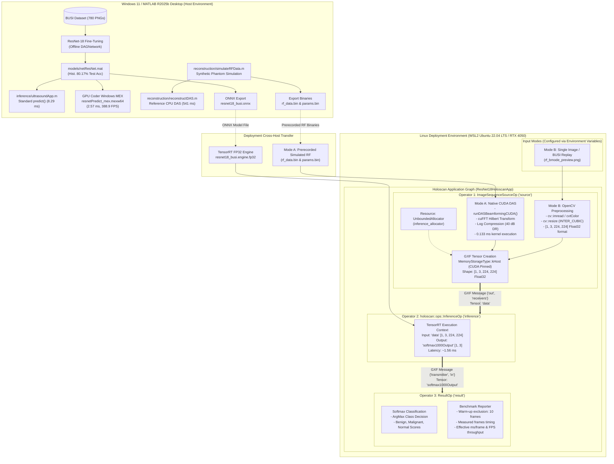

# Pipeline Architecture & Operator Flow

**System Architecture & Deployment Topology**  
**Date:** October 20, 2026  
**Implementation Source:** [`holoscan/app/main.cpp`](file:///c:/Users/anura/Desktop/RealTimeMedicalImaging/holoscan/app/main.cpp), [`reconstruction/cuda/das_kernel.cu`](file:///c:/Users/anura/Desktop/RealTimeMedicalImaging/reconstruction/cuda/das_kernel.cu), [`holoscan/app/resnet18.yaml`](file:///c:/Users/anura/Desktop/RealTimeMedicalImaging/holoscan/app/resnet18.yaml)

---

## 1. High-Level Architectural Overview

The project implements two distinct computing environments tailored to their respective roles in medical ultrasound research:

1. **Development, Simulation & Reference Environment (Windows 11 / MATLAB R2025b):**
   - Offline fine-tuning of ResNet-18 DAGNetwork on the Breast Ultrasound Images (BUSI) dataset (`models/netResNet.mat`).
   - Interactive MATLAB desktop application (`inference/ultrasoundApp.m`).
   - Validated Windows GPU Coder MEX compilation (`resnetPredict_mex.mexw64`, $3.22\times$ speedup, $2.57\text{ ms/frame}$).
   - Synthetic acoustic RF simulation (`reconstruction/simulateRFData.m`) and reference CPU Delay-and-Sum (DAS) beamforming (`reconstruction/reconstructDAS.m`).
   - Generation and verification of export artifacts (`rf_data.bin`, `params.bin`, `resnet18_busi.onnx`).

2. **Real-Time Streaming Deployment Pipeline (Linux WSL2 Ubuntu 22.04 / NVIDIA Holoscan SDK 4.6):**
   - Native C++ / CUDA implementation compiled via CMake and GCC 11.4 / CUDA 13.4 (`resnet18_holoscan`).
   - Prerecorded / simulated RF data input streamed frame-by-frame (or B-mode image replay).
   - High-throughput native CUDA DAS beamforming (`das_kernel.cu`) with cuFFT Hilbert transform for analytical envelope extraction.
   - Dynamic range compression and B-mode frame formatting ($224 \times 224 \times 3$ Float32).
   - NVIDIA TensorRT FP32 engine execution via `holoscan::ops::InferenceOp`.
   - Result extraction and benchmark reporting via `ResultOp`.

A vector illustration is available in [pipeline_architecture.svg](file:///c:/Users/anura/Desktop/RealTimeMedicalImaging/docs/pipeline_architecture.svg).

---

## 2. Architecture Diagram (Mermaid Source)

---

## 3. Holoscan Operator & Flow Specifications

### 3.1 Operator 1: `ImageSequenceSourceOp` ("source")
- **Class:** Custom `holoscan::Operator` subclass defined in [`holoscan/app/main.cpp`](file:///c:/Users/anura/Desktop/RealTimeMedicalImaging/holoscan/app/main.cpp#L263).
- **Execution Condition:** `holoscan::make_condition<CountCondition>(g_total_frames)` where total frames = warm-up ($10$) + measured frames ($N$).
- **Memory Resource:** `holoscan::make_resource<UnboundedAllocator>("inference_allocator")`.
- **Mode A Processing (CUDA RF DAS):**
  1. Calls `runDASBeamformingCUDA()` implemented in [`reconstruction/cuda/das_kernel.cu`](file:///c:/Users/anura/Desktop/RealTimeMedicalImaging/reconstruction/cuda/das_kernel.cu).
  2. Executes GPU Delay-and-Sum beamforming with sub-sample parabolic interpolation and dynamic apodization across $128$ physical transducer elements and $224 \times 224$ focal grid points.
  3. Applies cuFFT forward 1D FFT, zeroing of negative frequencies, and inverse 1D FFT for exact analytical Hilbert envelope detection.
  4. Applies log compression: $B = 20 \log_{10}(E / \max(E)) + 40\text{ dB}$, normalized to $[0, 255]$ uint8.
  5. Formats output buffer into NCHW Float32 $[1, 3, 224, 224]$.
- **Mode B Processing (Image File Replay):**
  1. Reads image via `cv::imread` with `IMREAD_UNCHANGED`.
  2. Converts BGR to Grayscale via `cv::cvtColor(COLOR_BGR2GRAY)`.
  3. Resizes to $224 \times 224$ using bicubic interpolation (`cv::INTER_CUBIC`).
  4. Duplicates single-channel grayscale across $3$ color planes to match ResNet-18 input expectations $[1, 3, 224, 224]$.
- **Output Port:** Emits `holoscan::TensorMap` with key `"data"` over port `"out"`.

### 3.2 Operator 2: `holoscan::ops::InferenceOp` ("inference")
- **Class:** Built-in Holoscan operator `holoscan::ops::InferenceOp` configured via [`holoscan/app/resnet18.yaml`](file:///c:/Users/anura/Desktop/RealTimeMedicalImaging/holoscan/app/resnet18.yaml).
- **Backend:** TensorRT (`backend: "trt"`).
- **Model Engine:** `resnet18_busi.NVIDIAGeForceRTX4050LaptopGPU.8.9.20.trt.10.16.1.11.engine.fp32` (cached FP32 TensorRT engine generated from ONNX export).
- **Input Map:** `resnet18: ["data"]`.
- **Output Map:** `resnet18: ["softmax1000Output"]`.
- **Flow Connections:**
  - Input: `add_flow(source, inference, {{"out", "receivers"}})`
  - Output: `add_flow(inference, result, {{"transmitter", "in"}})`

### 3.3 Operator 3: `ResultOp` ("result")
- **Class:** Custom `holoscan::Operator` subclass defined in [`holoscan/app/main.cpp`](file:///c:/Users/anura/Desktop/RealTimeMedicalImaging/holoscan/app/main.cpp#L357).
- **Input Port:** Receives `holoscan::TensorMap` on port `"in"`.
- **Classification Computation:** Reads 3-element float array from `"softmax1000Output"` representing softmax probabilities for `[Benign, Malignant, Normal]`, selecting the maximum index as the predicted diagnosis.
- **Benchmark Timing:** Excludes the first $10$ warm-up frames from latency accumulation. Computes total elapsed steady-state time, effective milliseconds per frame, and frame rate (FPS).

---

## 4. Key Architectural Decisions & Evidence Boundaries

1. **No Live ADC Hardware Claim:** The system ingests prerecorded, physically meaningful simulated RF data (`rf_data.bin`). It does not interface directly with physical ultrasound transducer hardware or an ADC board.
2. **Out-of-Domain Classification Notice:** The ResNet-18 classifier was fine-tuned on clinical B-mode breast ultrasound images from the BUSI dataset. When evaluated on synthetic point-scatterer phantom reconstructions, its predictions reflect algorithmic responses to synthetic echo distributions, not verified clinical diagnoses.
3. **GPU Coder Boundary:** MATLAB GPU Coder was used to generate and validate Windows MEX binaries (`resnetPredict_mex.mexw64`) for desktop MATLAB acceleration. Holoscan deployment uses native handwritten CUDA C++ and TensorRT. GPU Coder-generated C++ code was evaluated as a standalone Linux static library proof of concept (`libgpusimpletest.a`), but is not part of the active Holoscan execution graph.
